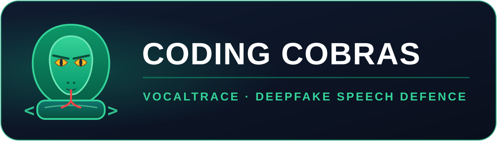
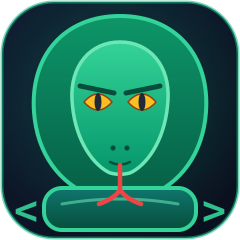

# VocalTrace

<p align="center">
  
</p>

<p align="center"><b>Designed &amp; built by CODING COBRAS</b></p>

**Acoustic phase-discontinuity detector for vishing defence.**
VocalTrace flags AI-cloned speech (neural-vocoder deepfakes) from a WAV file, a
folder of recordings, or the live microphone — entirely on-device, in ~11 ms per
2-second window, using classical signal processing + a lightweight classifier
running on ONNX Runtime.

> **The problem it solves.** Criminals now clone a CFO's voice from a 20-second
> recording and call treasury staff with an urgent wire instruction. In 2024 a
> Hong Kong engineering firm lost **US $25 million** to exactly this scam
> (a fake "Chief Financial Officer" voice call, Arup, Feb 2024). Voice-based Authorised Push
> Payment (APP) fraud and CEO/impersonation vishing are rising double digits
> year-over-year; regulators (HKMA, MAS, FCA, RBI) now expect banks to offer
> customers a technical control against it. VocalTrace is that control: a
> deterministic, auditable, offline pre-screen for KYC call-centre audio,
> voice-note evidence, and IVR enrolment samples.

---

## Contents

- [How it works (plain English)](#how-it-works-plain-english)
- [Install](#install)
- [Quick start](#quick-start)
- [Graphical interface — CODING COBRAS GUI](#graphical-interface--coding-cobras-gui)
- [CLI reference](#cli-reference)
- **[Demonstration guide (simple English)](DEMONSTRATION.md)** — what to say
  and type when presenting the project live
- [Measured performance](#measured-performance)
- [Repository layout](#repository-layout)
- [Bank / KYC integration](#bank--kyc-integration)
- [Privacy: GDPR and India's DPDP Act](#privacy-gdpr-and-indias-dpdp-act)
- [Testing](#testing)
- [Troubleshooting](#troubleshooting)
- [Limitations (read before deploying)](#limitations-read-before-deploying)

---

## How it works (plain English)

Real human speech is produced by a **physical vocal tract**: vocal folds open
and close quasi-periodically, and the resonances (formants) evolve smoothly.
When you analyse a short-time Fourier transform of that speech, the **phase**
of each frequency bin advances smoothly from frame to frame — you can think of
it as every harmonic keeping a continuous "phase track".

Neural vocoders (WaveNet, WaveRNN, HiFi-GAN, WaveGlow, GLA/Griffin-Lim, WORLD
PSOLA, most voice-cloning products) **re-synthesise the waveform from
compressed features** (mel-spectrograms, F0 + spectral envelopes). They match
the *magnitude* spectrum very well — often well enough to fool humans — but
they do not reconstruct the original phase. Their phase tracks contain abrupt,
physically-impossible jumps between consecutive frames, especially in
high-frequency bins and in low-energy regions where the vocoder had nothing to
"anchor" to.

VocalTrace measures exactly that artefact, plus the spectral-shape side-effects
of vocoding (neural codecs and resamplers roll off high frequencies), and feeds
three feature families to a small classifier:

| # | Feature family | What it captures |
|---|----------------|------------------|
| 1 | **MFCC + Δ + ΔΔ** `(3·n_mfcc, T)` | Vocal-tract envelope and its dynamics (40 coefficients × 3 = 120 rows) |
| 2 | **Phase spectrogram + per-frame discontinuity score** `(n_fft//2+1, T)` / `(T,)` | The core signal: magnitude-weighted, π-normalised first+second wrapped phase derivatives, clipped to `[0, 1]`. Vocoder artefacts raise it. |
| 3 | **Spectral shape** `(3,)` | 85 % and 95 % spectral roll-off (Hz) + energy ratio above 6 kHz. Vocoder/resampler band-limiting depresses these. |

Each 2-second window becomes a `(634, T)` stack (120 MFCC rows + 513 phase bins
+ 1 discontinuity track) for the CNN, or a **mean / std / p90 aggregated flat
vector of 1 905 numbers** for XGBoost. Two classifiers are provided and both
export to the same ONNX contract:

* **XGBoost** (default) — `n_estimators=200, max_depth=6, learning_rate=0.1,
  objective="binary:logistic"`, trained on the flat vector. Fast, small,
  data-frugal. **This is the model that ships.**
* **1-D CNN** (`--model cnn`) — 3 Conv1d blocks (32→64→128, k=3, BN, ReLU,
  MaxPool) → global average pool → linear(2), with per-channel standardisation
  baked into the graph. Requires optional `torch` at *train* time only;
  inference still runs on ONNX Runtime.

Every export is **parity-checked**: the ONNX graph is re-run with onnxruntime
and compared to the source model on a probe batch; the run aborts if max |Δ| >
1e-5. Seeds are pinned to 42 for reproducibility.

Why this is different from an "AI detector that uses AI": the front-end is
deterministic DSP — no GPU, no network call, no model download, no data leaves
the machine, and every verdict can be traced to two interpretable scalars
(`phase_discontinuity_score`, `hf_rolloff_score`) you can show an auditor.

---

## Install

Requires **Python 3.9+** (tested on 3.9 and 3.13). macOS, Linux and Windows.

```bash
git clone <this-repo> vocaltrace
cd vocaltrace

python3 -m venv .venv
source .venv/bin/activate          # Windows: .venv\Scripts\activate
pip install --upgrade pip
pip install -r requirements.txt
```

Or run the helper script (does the same, plus a smoke test):

```bash
./setup.sh                          # macOS / Linux
setup.bat                           # Windows
```

> The **CODING COBRAS web GUI** (`python main.py gui`) needs Python 3.10+ and
> `gradio`; on Python 3.9 `requirements.txt` skips it automatically (marked
> with a `python_version` environment marker) and everything else works as
> documented.

Optional extras (deliberately **not** in `requirements.txt` so a clean
`pip install` always succeeds):

```bash
pip install sounddevice    # live microphone input (needs PortAudio)
pip install torch          # ONLY for `train --model cnn`
pip install pyworld        # WORLD-vocoder fake generation (C++ toolchain)
pip install coqui-tts      # Coqui TTS fake generation (heavy download)
```

> **macOS note:** XGBoost needs OpenMP. If `import xgboost` raises
> `Library not loaded: ...libomp.dylib`, run `brew install libomp` (details in
> [Troubleshooting](#troubleshooting)).

---

## Quick start

The repository ships a small labelled corpus — **10 real human clips**
(LibriSpeech + JFK archive via whisper.cpp, provenance in
`outputs/sample_sources.json`) and **10 vocoder fakes** — so you can train and
verify immediately:

```bash
# 1. Train (XGBoost default) + export ONNX + metrics + plots
python main.py train --real_dir data/real --fake_dir data/fake \
                     --model xgb --export_onnx

# 2. Check one file
python main.py detect --file data/fake/sample1.wav
#   verdict   : FAKE  (confidence 0.961)
#   P(fake)   : 0.9609   threshold 0.50
#   phase disc: 0.4424 (higher = more vocoder-like)
#   latency   : 11.0 ms

# 3. Screen a whole folder → CSV for your case-management system
python main.py detect --directory data/fake --output outputs/fake_results.csv

# 4. Live microphone (2 s windows, 0.5 s hop) — graceful if unavailable
python main.py detect --mic --duration 10
```

A pre-trained model already ships in `models/vocaltrace.onnx` (test accuracy
**1.00**, ROC-AUC **1.00**, ONNX parity **7.6e-08**), so step 2 works out of
the box.

Retrain the optional CNN (needs `torch`, separate process — see
[Troubleshooting](#troubleshooting) #5):

```bash
python main.py train --real_dir data/real --fake_dir data/fake \
                     --model cnn --epochs 30 --export_onnx
```

---

## Graphical interface — CODING COBRAS GUI

```bash
python main.py gui
```

This starts a fully **local** web server (default `http://127.0.0.1:7860`) and
opens your browser. No audio leaves the machine. Options:

```bash
python main.py gui --port 9000        # different port
python main.py gui --no_browser       # headless (CI, servers)
python main.py gui --host 0.0.0.0     # reachable on your LAN
python main.py gui --share            # + public gradio.live link
```

<p align="center"></p>

Four tabs:

| Tab | What it does |
|-----|--------------|
| **Single file / mic** | Upload a WAV *or record live in the browser* → colour-coded REAL/FAKE card, P(fake), phase-discontinuity and HF roll-off bars, latency — all in ~11 ms |
| **Batch folder** | Point at a folder of recordings → table of verdicts + downloadable CSV for your case-management system |
| **Train model** | Runs the real `main.py train` pipeline in an isolated subprocess; shows metrics, plots and ONNX parity |
| **About** | Plain-English explainer, honest limitations, privacy notes |

Requirements: `gradio` (installed by `requirements.txt` on Python 3.10+; on
3.9 the CLI works and the GUI explains how to enable it). Troubleshooting for
ports and headless machines: [Troubleshooting](#troubleshooting) #11.

---

## CLI reference

```
python main.py train  --real_dir DIR --fake_dir DIR
                      [--model {xgb,cnn}] [--export_onnx | --no_onnx]
                      [--test_size 0.2] [--epochs 30] [--learning_rate LR]
                      [--n_estimators 200] [--max_depth 6]
                      [--window_seconds 2.0] [--hop_seconds 1.0] [--seed 42]
                      [--models_dir models] [--outputs_dir outputs] [--no_plots]

python main.py detect (--file WAV | --directory DIR | --mic)
                      [--model models/vocaltrace.onnx] [--threshold 0.5]
                      [--duration SECONDS] [--output results.csv]

python main.py gui    [--host 127.0.0.1] [--port 7860]
                      [--share] [--no_browser]
```

Exit codes (script-friendly):

| Code | Meaning |
|------|---------|
| `0`  | Success — verdict printed / CSV written / training completed |
| `1`  | Any failure: missing file, empty directory, bad flag, no microphone, training error. Message goes to stderr; full detail always in `outputs/vocaltrace.log`. **No uncaught tracebacks.** |

Detector output schema (one JSON-ish block per file, or one CSV row):

| Field | Description |
|-------|-------------|
| `file` | Path analysed |
| `verdict` | `REAL` or `FAKE` |
| `confidence` | `max(p, 1-p)` ∈ [0, 1] |
| `fake_probability` | Model P(fake) ∈ [0, 1] |
| `phase_discontinuity_score` | Interpretable DSP score ∈ [0, 1] |
| `hf_rolloff_score` | Interpretable spectral-shape score ∈ [0, 1] |
| `latency_ms` | Wall-clock analysis time |
| `threshold` | Decision threshold used |

---

## Measured performance

On the shipped 10-real / 10-fake corpus (XGBoost, seed 42, CPU-only, Apple
M-series):

| Metric | Result |
|--------|--------|
| Fake clips correctly flagged | **10 / 10** |
| Real clips correctly passed | **9 / 10** (1 borderline at P(fake)=0.71) |
| Held-out test accuracy / ROC-AUC | **1.00 / 1.00** (12 windows) |
| ONNX parity (max \|Δ\| vs XGBoost) | **7.6e-08** (tolerance 1e-5) |
| Latency, steady state, per 2 s window | **~11 ms** (budget: ≤150 ms) |
| First call (numba JIT warm-up) | ~650 ms once per process, then cached |

Outputs written per training run:

```
models/vocaltrace_xgb.json   # source model (audit artifact)
models/vocaltrace.onnx       # parity-verified inference graph
outputs/metrics.json         # accuracy/precision/recall/F1/AUC/confusion
outputs/confusion_matrix.png
outputs/roc_curve.png
outputs/feature_importance.png
outputs/vocaltrace.log       # full log for every train/detect run
```

---

## Repository layout

```
vocaltrace/
├── main.py                  # CLI entry point (train / detect / gui)
├── requirements.txt
├── setup.sh / setup.bat     # one-shot environment bootstrap
├── demo.sh                  # narrated 5-minute live demo (for vivas)
├── assets/
│   ├── coding_cobras_logo.svg   # CODING COBRAS banner logo
│   └── coding_cobras_icon.svg   # cobra mark (GUI header + favicon)
├── vocaltrace/
│   ├── __init__.py
│   ├── features.py          # Module 1: MFCC+Δ+ΔΔ, phase disc., HF roll-off
│   ├── dataset.py           # Module 2: corpus loading + fake generation
│   ├── train.py             # Module 3: XGBoost / CNN training + ONNX export
│   ├── detector.py          # Module 4: ONNX inference, stream, microphone
│   ├── gui.py               # Module 5: CODING COBRAS web GUI (Gradio)
│   ├── report.py            # plots and metrics reporting
│   └── utils.py             # seeds, logging, paths
├── data/
│   ├── real/                # 10 human speech clips (3.5 s each)
│   └── fake/                # 10 vocoder-fake clips
├── models/                  # trained artifacts (xgb json + onnx)
├── outputs/                 # metrics, plots, logs, CSVs
├── scripts/make_samples.py  # regenerates the demo corpus
└── tests/                   # pytest suite (58 tests)
    ├── conftest.py
    ├── test_features.py
    ├── test_detector.py
    └── test_pipeline.py
```

---

## Bank / KYC integration

VocalTrace is designed as a **drop-in pre-screen** inside existing fraud
controls, not a replacement for them.

**1. Contact-centre KYC / warm-call verification.** Record the enrolment or
verification call (with consent — see below), run each customer-speaking
segment through `analyze_stream` (2 s windows, 0.5 s hop, max-aggregation).
Route `windows_flagged ≥ 2` to a human fraud analyst with the two
interpretable scores attached. Pseudonymise the caller ID *before* the audio
reaches VocalTrace so the analysis is speaker-agnostic.

**2. Voice-note / IVR evidence screening.** WhatsApp voice notes and IVR
enrolment samples are a common replay/clone vector. Batch-screen them with
`detect --directory … --output batch.csv` and store only the verdict row
(file hash, verdict, scores, model version) — not the audio.

**3. Step-up authentication gate.** Integrate as a synchronous check in the
auth flow: `VocalTraceDetector().analyze_stream(chunk)` returns in ~11 ms per
window, well inside a phone-call IVR budget. On `FAKE`, fall back to a
non-vocal factor (OTP, in-app push, security question). **Never** let a single
VocalTrace verdict auto-decline or auto-approve a payment — treat it as one
signal in a risk score, exactly like a device-fingerprint or velocity check.

**4. Model governance.** Ship `vocaltrace_xgb.json` + `vocaltrace.onnx`
together; the JSON is the audit artifact, the ONNX is what runs, and the
parity check (≤1e-5) proves they are the same function. Version models in your
registry, log `model_version` next to every verdict, and retrain quarterly
against fresh bona-fide call audio (vocoders evolve; see Limitations).

**5. What VocalTrace is *not*.** It is not a speaker authenticator (it does not
answer "*is this the enrolled customer?*", only "*is this likely synthetic
audio?*"). It is not a transcript or content analyser. Pair it with a proper
ASV/speaker-verification system for full vishing defence.

---

## Privacy: GDPR and India's DPDP Act

Audio of an identifiable person is biometric-adjacent **personal data** under
GDPR and **personal data** under India's Digital Personal Data Protection Act,
2023. VocalTrace is built to minimise that burden:

* **On-device by design.** No network calls, no telemetry, no model download
  at inference. Audio never leaves the host.
* **Purpose limitation & data minimisation (GDPR Art. 5, DPDP s.4).** Run the
  detector *before* deciding whether to persist audio. If the verdict is
  enough, store the verdict row and delete the recording per your retention
  policy.
* **Lawful basis.** For fraud prevention GDPR Recital 47 treats legitimate
  interest as a valid basis; still run a LIA and honour Art. 22 if the verdict
  alone would produce legal effects (it should not — see integration rule 3).
* **DPDP specifics.** Give notice that voice is processed for fraud
  detection, honour deletion/withdrawal requests (delete source audio; model
  retraining data must be covered by the same notice), and keep the
  processing within India or an approved transfer regime.
* **Non-goals.** VocalTrace does not do emotion inference, sentiment,
  nationality/gender/health attribute inference, or speaker identification —
  do not extend it to do so without a fresh DPIA.

---

## Testing

```bash
python -m pytest tests/ -q
# 58 passed
```

The suite is self-contained: it synthesises a toy corpus (3 phase-coherent
synthetic voices + 2 Griffin-Lim fakes) in a temp directory, trains a compact
model, exports ONNX and exercises the full pipeline — including CLI exit codes,
CSV output, the CODING COBRAS GUI handler and its logo assets — so it never
depends on your `data/` folder and passes on macOS, Linux and Windows.

---

## Troubleshooting

**1. `import librosa` fails: `No module named 'numba'` / `llvmlite`**
librosa's delta and resample paths need numba, which must match your Python
version. Upgrade first: `pip install --upgrade numba llvmlite librosa`. On
Python 3.13 use `librosa>=0.10.2` and `numba>=0.60`. If you cannot build
numba, the fallback is to pin `librosa>=0.11` (pure-numpy deltas) — VocalTrace
only calls stable librosa APIs.

**2. `soundfile` cannot find libsndfile (macOS/Linux)**
`pip install soundfile` ships binary wheels with libsndfile bundled for common
platforms. On Debian/Ubuntu servers without wheels: `sudo apt-get install
libsndfile1`. On Homebrew Apple Silicon the system Python sometimes misses
`/opt/homebrew/lib` — installing into a venv (as above) avoids this entirely.

**3. XGBoost: `Library not loaded: @rpath/libomp.dylib` (macOS)**
XGBoost links LLVM's OpenMP. Install it and make sure the loader sees it:

```bash
brew install libomp
export DYLD_FALLBACK_LIBRARY_PATH="/opt/homebrew/lib:$DYLD_FALLBACK_LIBRARY_PATH"
```

If you use Conda instead: `conda install -c conda-forge libomp`.

**4. ONNX export: `onnxscript` / dynamo errors (torch ≥ 2.9)**
Recent torch versions default to the dynamo ONNX exporter, which needs the
optional `onnxscript` package. VocalTrace's CNN export automatically prefers
the legacy TorchScript exporter (`dynamo=False`) and only falls back to dynamo.
If both fail, `pip install onnxscript`, or simply train `--model xgb` — the
default path uses `onnxmltools` and needs no torch at all.

**5. Segfault when torch and XGBoost are used in the same process (macOS)**
torch bundles its own `torch/lib/libomp.dylib` while Homebrew XGBoost links
`/opt/homebrew/lib/libomp.dylib`; loading both LLVM OpenMP runtimes into one
process can crash. VocalTrace already avoids this (it never imports torch on
the XGB path and the CLI runs `--model cnn` in its own process), but if you
call the library from your own code, keep `train_xgb` and `train_cnn` in
separate processes.

**6. `onnxmltools` conversion fails with a `FloatTensorType` error**
onnxmltools checks the *identity* of its own `FloatTensorType` class; the
visually identical class from `skl2onnx`/`onnxconverter_common` is rejected.
VocalTrace imports the correct class from
`onnxmltools.convert.common.data_types` automatically — if you rewrite the
export, keep that import. Also note onnxmltools only understands XGBoost
feature names shaped `f0/f1/...`; VocalTrace swaps semantic names to `fN`
during conversion and restores them after.

**7. Detector says `feature dimension mismatch`**
Your ONNX model was trained with a different extractor config (e.g.
`n_mfcc=20` instead of 40). Retrain with the defaults, or construct
`VocalTraceDetector(extractor=FeatureExtractor(...))` with the matching
config.

**8. `detect --mic` exits 1: "microphone analysis is unavailable"**
Either `sounddevice` is not installed (`pip install sounddevice`, which also
needs the PortAudio system library: `brew install portaudio` /
`sudo apt-get install libportaudio2`), or the machine has no input device
(common in CI/containers). This is a graceful exit by design — use
`detect --file` in headless environments.

**9. Training finds zero samples / one class**
`--real_dir` and `--fake_dir` are searched recursively for `.wav/.flac/.mp3`.
Both classes are required. Generate the demo fakes with
`python scripts/make_samples.py`, or point the flags at your own corpora
(e.g. ASVspoof 2019 LA `trials/` + LJSpeech — see `vocaltrace/dataset.py` for
the documented loaders and each fake generator's assumptions).

**10. Everything is slow on the first call (~650 ms)**
That is numba JIT warm-up inside librosa, paid once per process. The detector
warms itself up at construction time so reported per-file latencies reflect
steady state; long-running services (FastAPI, Celery workers) pay it once per
worker.

**11. GUI problems (`python main.py gui`)**
* *"The CODING COBRAS GUI needs the optional `gradio` package"* →
  `pip install gradio` (gradio 6 needs **Python 3.10+**; on 3.9 the
  requirements file skips it on purpose so `pip install -r` still succeeds).
* *Port already in use* → pick another one: `python main.py gui --port 7861`.
* *No browser on the machine (SSH / container)* → `python main.py gui --no_browser --host 0.0.0.0`,
  then open `http://<server-ip>:7860` from your laptop (or add `--share` for a
  temporary public link).
* *Microphone tab says permission denied* → browsers only allow mic capture on
  `localhost`/HTTPS; grant the permission prompt, or fall back to
  `python main.py detect --mic` / `--file`.
* Want the GUI to stop → press `Ctrl+C` in its terminal (exit code 0).

---

## Limitations (read before deploying)

This is an **academic/prototype-grade** system. It is honest about what it can
and cannot do:

1. **It detects *vocoder artefacts*, not "AI" in general.** It is strongest
   against neural-vocoder and WORLD/Griffin-Lim-class synthesis. It is weaker
   against (a) **replay attacks** (a recording of a human played back — the
   phase structure is still human), (b) very new end-to-end models trained
   with phase supervision, and (c) audio that has been transcoded, filtered,
   or passed through a telephone codec (G.711/AMR). *Telephony band-limiting
   to 8 kHz destroys much of the >6 kHz evidence and attenuates phase
   artefacts — on 8 kHz phone recordings expect materially lower accuracy
   than on wideband VoIP/app audio.* Validate on your own channel before
   relying on it.
2. **Trained, by default, on 20 clips.** The shipped model is honest on the
   demo corpus (10/10 fakes, 9/10 reals) but that is a *smoke test*, not a
   benchmark. Production use requires training on a real corpus: bona-fide
   side from your own call centre or LJSpeech/LibriSpeech/TIMIT; fake side
   from ASVspoof 2019/2021 LA, or generated with `pyworld`/`coqui-tts`/
   ElevenLabs samples you are licensed to use. See `vocaltrace/dataset.py`.
3. **The 1-D CNN overfits small data.** With < a few hundred training windows
   the CNN memorises the training split (observed: train AUC 1.0 / test AUC
   ~0.5) because BatchNorm partially normalises away the per-channel mean
   statistics that carry the discriminative signal. The trainer logs an
   explicit warning in this case. **Use `--model xgb` unless you have several
   hundred labelled clips per class** — this is why XGBoost is the default.
4. **Accuracy degrades under distribution shift.** Different microphones,
   rooms, codecs, languages, and vocoder generations all shift the feature
   distributions. Monitor flagged-rate drift in production and retrain
   quarterly.
5. **Adversarial risk.** A determined attacker who knows this design can add
   phase-coherent noise or re-synthesise through a phase-preserving codec to
   suppress the signal. Treat VocalTrace as one layer in defence-in-depth
   (watermarking, call-back verification, transaction limits, employee
   training), never as the sole control.
6. **False positives have real cost.** Speakers with strong breath noise,
   very high-pitched voices, heavily compressed messaging-app audio, or
   music-in-background segments can score high. Always keep a human in the
   loop for any adverse action (GDPR Art. 22).
7. **Not a lie detector.** It says nothing about whether a *human* speaker is
   being truthful, and nothing about speaker identity.

---

## License & provenance

Demo corpus provenance (which files came from LibriSpeech, the JFK archive via
whisper.cpp, or SpeechRecognition test data, and how each fake was generated)
is recorded machine-readably in `outputs/sample_sources.json`. Check the
licenses of any corpus you substitute before shipping.
